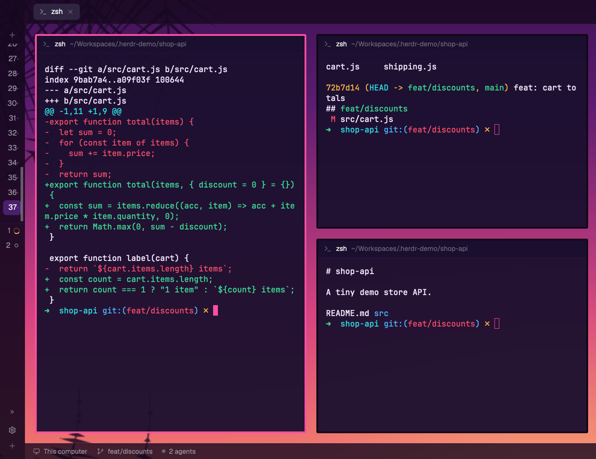
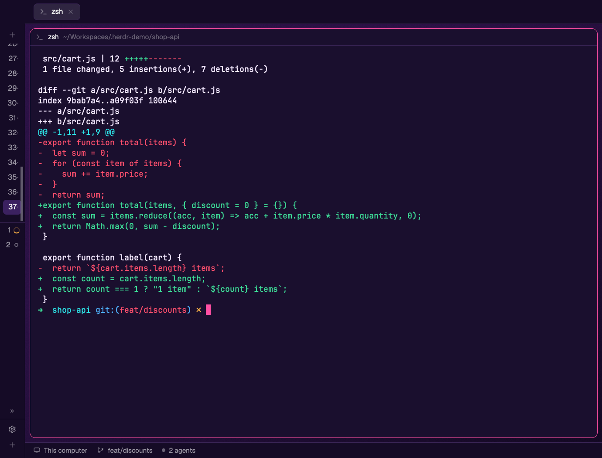

# Vice Poster for the Herdr app

The [Herdr app](https://herdr.dev) window as a sunset poster: panes as framed tiles over a purple-to-orange evening sky with palm silhouettes, the sky showing between and through them. Hot pink neon on the focused tile, sunset orange buttons and terminal colors from the same evening.



## Install

Tell your agent:

```
Read ~/.config/herdr-app/AGENTS.md, then add this layout: https://github.com/jacksonpires/herdr-vice-sunset
```

Or by hand: copy `layouts/*` to `~/.config/herdr-app/layouts/`, `themes/*` to `~/.config/herdr-app/themes/` and `backgrounds/vice-poster.png` to `~/.config/herdr-app/backgrounds/`. Then pick **Vice Poster** in Settings or run `herdr-app do layout.switch --name vice-poster`. `ctrl-shift-l` switches back.

`RECIPE.md` describes the layout in full, so an agent can rebuild it from scratch. `backgrounds/sky.py` redraws the sky.

## Also here: Vice Sunset

A calm version with the same palette: Herdr's usual window with a purple gradient behind the panes, no sky or palms. It is in [`extras/vice-sunset`](extras/vice-sunset), with its own instructions.



The palette and drawings are an original take on a sunset mood. They are not affiliated with or taken from any game or brand.

## License

MIT
