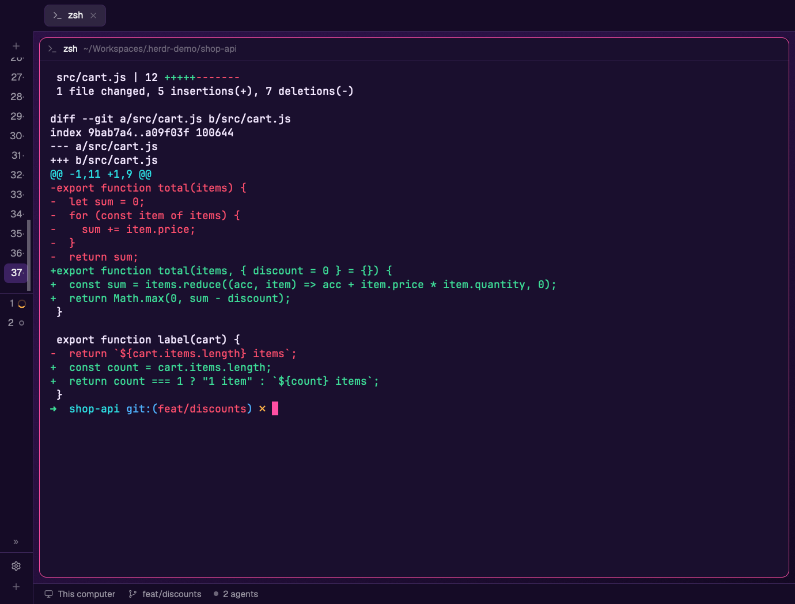

# Vice Sunset

Herdr's default window at dusk on a Florida-style coast: a deep purple sky behind the panes, hot pink neon on whatever has focus, a sunset orange for primary buttons, and terminal colors taken from the same evening (magenta, turquoise sea, palm green, warm yellow, ocean blue). The layout is Herdr's own `main`, with this look added to it.

## What you see

- **The window** is Herdr's `main` layout: spaces and agents on the left, tabs as pills on top, panes as cards, Files and Changes on the right, a status bar at the bottom. Nothing moves or changes size.
- **The background** behind the cards is a gradient from `#2b1145` (top left) to `#120821`, at 165°.
- **Terminals** have a `#1a0f2e` background, `#f3e8ff` text, a `#ff4fa3` cursor and `#4a2a6e` selection.
- **Panels** (sidebars and bars) use `chrome` `#150b26` and `canvas` `#120821`, with `#3a2556` borders and `#3b2160` for the selected row.
- **Focus** is hot pink: the focused pane's border, the selected space and the cursor use `accent` `#ff4fa3`, with `#1a0f2e` text on it.
- **Primary buttons** (Commit, Send) are sunset orange, `solid` `#ff7a3d` with `#1a0f2e` text.
- **ANSI colors**, normal then bright:
  - black `#2a1a40` / `#6b5a85`
  - red `#ff4f6d` / `#ff7a8f`
  - green `#3ddc97` / `#6ff0b8`
  - yellow `#ffb347` / `#ffd166`
  - blue `#4fb3ff` / `#7cc7ff`
  - magenta `#ff4fd8` / `#ff8ae2`
  - cyan `#2de2e6` / `#7ff3f5`
  - white `#e8dcf5` / `#ffffff`

## How it behaves

- Agent status keeps Herdr's meaning with the sunset colors: working is orange `#ffb347`, done is green `#3ddc97`, blocked is red `#ff4f6d`, idle stays dim.
- Everything else is Herdr's `main`: same keys, same clicks, same panels.
- It is dark only. With the system in light mode the layout still shows this theme.

## Built from

- `layouts/vice-sunset.json`: a copy of Herdr's shipped `main` layout (version 0.1.9) with three root fields added: `"theme": "vice-sunset"`, `"background": {"gradient": ["#2b1145", "#120821"], "angle": 165}` and `"preview": "layouts/vice-sunset.png"`. It uses only Herdr's shipped mods (`workspace-chrome`, `spaces`, `agents`, `tabs`, `files`, `changes`, `workspace-status`), so there is no `mods/` folder.
- `themes/vice-sunset.json`: `background`, `foreground`, `selection`, `cursor`, the 16 `ansi` colors above, and `colors` overriding `accent`, `accent_foreground`, `solid`, `solid_foreground`, `chrome`, `canvas`, `border`, `selected`, `working`, `done` and `blocked`. Herdr derives the other panel colors from these.
- `layouts/vice-sunset.png`: the picture Settings shows for the layout (the same as `preview.png`).

## Watch out

- **Copy the theme too.** Adding the layout means copying `layouts/vice-sunset.json` and `layouts/vice-sunset.png` to `layouts/` and `themes/vice-sunset.json` to `themes/`. Without the theme file the layout falls back to Herdr's default colors.
- Because the theme has the layout's name, Settings offers it only while this layout shows, as Herdr does with `win98`. To use the colors in another layout, copy the theme file under another name and pick it there.
- The layout is a copy of `main` from Herdr's app version that shipped `main` 0.1.9. A later `main` can add things this copy doesn't have; when that matters, clone the newer `main` (`layout.clone`) and add the three root fields again.
- The colors are an interpretation of a sunset palette, not taken from any game's or brand's files.

## Done when

- `layouts/vice-sunset.json` and `themes/vice-sunset.json` are valid JSON, and `layout.switch {name: "vice-sunset"}` shows the window with no `layout.error`.
- The focused pane has a hot pink border, the space behind the cards is the purple gradient, and `git diff --color` in a terminal shows pink-red removals and green additions on the dark purple background.
- The Changes panel's Commit button is orange.
- `ctrl-shift-l` switches back to the previous layout, which keeps its own look.
